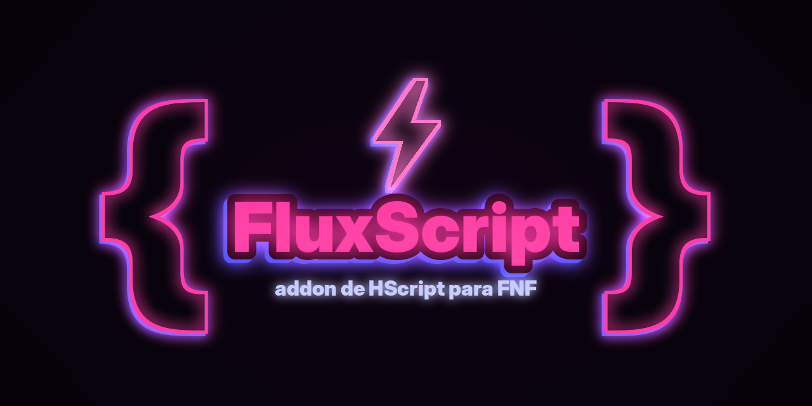

<p align="center"></p>

# FluxScript

Addon de HScript por **joaquinalonso**, exclusivo para el uso de FNF. Se piensa expandir a P-Slice Engine y muchos más.

FluxScript es el HScript de Psych Engine 1.0 ([hscript-iris](https://github.com/crowplexus/hscript-iris)) con cosas extra para hacer mods más rápido. Un `.hx` de Psych funciona igual en FluxScript, y todo lo nuevo es opcional.

Los scripts son archivos `.flux` (y `.fluxg` para los scripts globales).

| Engine | Estado |
|---|---|
| [Flux Engine](https://github.com/darnellpsych-funkin/FNF-FluxEngine) | Viene incluido: canciones, escenarios, personajes, eventos, menús y scripts globales |
| Psych Engine 1.0.4 | Se puede agregar (ver [Agregarlo a un engine](#agregarlo-a-un-engine)) |
| P-Slice Engine | Próximamente |

## Lo nuevo

### Clases sin `import`

Cualquier clase del juego se usa directo. Si un nombre que empieza con mayúscula no existe, FluxScript busca una clase con ese nombre en Flixel, OpenFL, Haxe y los paquetes de Psych (`backend`, `objects`, `states`, `substates`, `psychlua`...).

```haxe
var fondo = new FlxBackdrop(Paths.image('menuDesat'));
var icono = new HealthIcon('bf');
```

El `import` sigue funcionando igual, y uno de algo que no existe ya no corta el script: avisa y sigue.

### Los campos del juego directo

Los campos del estado del juego (el PlayState o el menú) se leen y se cambian sin `game.`:

```haxe
health = 2;
songScore += 100;
boyfriend.visible = false;
camHUD.alpha = 0.5;
```

Si el engine ya le dio al script una variable con ese nombre (como `curBeat`, `combo` o `misses` en Psych), se usa la variable. Para cambiar el valor del juego en esos casos, usa `game.` (`game.combo = 0`).

### Textos con variables

En las comillas simples, `$nombre` y `${expresión}` se reemplazan por su valor (como en Haxe). `$$` es un `$`. Las comillas dobles no cambian.

```haxe
texto.text = 'Beat $curBeat - vida ${Math.round(health * 50)}%';
```

### Varias funciones para el mismo evento: `on` y `off`

```haxe
on('beatHit', function() fondo.color = color('#FF66CC'));
on('beatHit', function() texto.text = 'Beat $curBeat');

function onBeatHit() { /* también se llama, como siempre */ }

off('beatHit'); // las quita todas (o off('beatHit', función) para una sola)
```

`'beatHit'` y `'onBeatHit'` son lo mismo. Si el script también tiene la función, se llaman todas.

### `shared`: datos que duran toda la partida

Lo comparten todos los FluxScript, y no se borra al cambiar de canción o de menú:

```haxe
shared.canciones = (shared.canciones ?? 0) + 1;
```

### `wait`, `every` y `color`

```haxe
wait(1.5, function() texto.visible = false);   // una vez, en 1.5 segundos
every(1, function() {                           // cada segundo...
	segundos++;
	return segundos < 10;                       // ...hasta que devuelva false
});
var rosa = color('#FF3EA5');                   // o color(0xFFFF3EA5), o FlxColor.PINK
```

`wait` y `every` devuelven el `FlxTimer` (se puede cancelar con `.cancel()`).

### `task.wait`: esperar en medio de una función (como en Luau)

`task.wait(segundos)` como una línea sola dentro de una función espera ahí mismo, sin timers ni funciones adentro de funciones:

```haxe
function onSongStart() {
	for (n in [3, 2, 1]) {
		texto.text = '$n';
		task.wait(0.5);
	}
	texto.text = '¡Ya!';
	var pasaron = task.wait(1); // devuelve los segundos que esperó
	texto.text = '';
}
```

Funciona en el cuerpo de la función y dentro de `if`/`else`, `switch`, `while`, `do`-`while` y `for` (con `break` y `continue`). `wait(segundos)` con un solo argumento es lo mismo, y `task.wait()` espera un frame. Las esperas se pausan con el juego, como los timers de Psych.

Las tareas, como en Luau:

```haxe
var luces = task.spawn(function() {   // corre ya, y sigue sola
	while (true) {
		camGame.zoom += 0.03;
		task.wait(Conductor.crochet / 1000);
	}
});
task.delay(2, function(a, b) trace(a + b), 1, 2); // en 2 segundos, con argumentos
task.defer(function() trace('el próximo frame'));
task.cancel(luces); // o luces.cancel(): ya no sigue
```

No se puede: `task.wait` dentro de una expresión (`trace(task.wait(1))`), dentro de `try`/`catch` o fuera de una función (avisa con la línea). Ojo: una función vuelve en su primer `task.wait`, así que si otra función la llamó, esa sigue sin esperar (para eso está `task.spawn`).

### `require`: módulos

```haxe
var cuenta = require('modules/cuenta'); // modules/cuenta.flux (o .hx)
trace(cuenta.numeros(3));
```

El módulo se ejecuta una sola vez y todos los que lo piden reciben lo mismo. Exporta sus funciones y las variables sin `var` (con `var` son privadas), o lo que devuelva con `return {...}`. Se busca al lado del script y en los mods, y se vuelve a cargar en cada estado (menú o canción).

También: `importScript('archivo')` ejecuta otro `.flux` dentro de este (comparten todo), y `loadstring(código)` devuelve una función que ejecuta ese código.

### Más de Lua y Luau

- `print(a, b...)` y `warn(...)`: un mensaje y un aviso.
- `typeof(valor)`: `'Int'`, `'Float'`, `'String'`, `'Bool'`, `'Array'`, `'Function'`, `'Object'`, `'null'` o la clase (`'FlxSprite'`).
- `tostring(v)`, `tonumber('12')` (también `'0x1F'` y `tonumber('ff', 16)`; `null` si no es un número).
- `pcall(función, args...)` devuelve `[true, resultado]` o `[false, error]`; `xpcall(función, alFallar, args...)`; `error('mensaje')` y `assert(valor, 'mensaje')`.
- `math`: `clamp`, `round`, `sign`, `lerp`, `map`, `floor`, `ceil`, `abs`, `sqrt`, `min`, `max`, `pow`, `random()` (`math.random(1, 6)` como en Lua), `pi`, `huge`...
- `os.time()`, `os.clock()`, `os.date('%H:%M')` (u `os.date('*t')`) y `tick()`.
- `fileExists`, `readFile`, `parseJson` y `toJson`.

### La API de Lua de Psych

Las funciones de los `.lua` de Psych están con los mismos nombres y argumentos, así un script de Lua se pasa a FluxScript casi copiando:

- **Propiedades**: `getProperty`, `setProperty`, `getPropertyFromClass`, `setPropertyFromClass`, `getPropertyFromGroup`, `setPropertyFromGroup`, `callMethod`, `callMethodFromClass`, `getObjectOrder`, `setObjectOrder`, `createInstance`, `addInstance`, `instanceArg`.
- **Sprites**: `makeLuaSprite`, `makeAnimatedLuaSprite`, `makeGraphic`, `loadGraphic`, `loadFrames`, `loadMultipleFrames`, `addLuaSprite`, `removeLuaSprite`, `luaSpriteExists`, `addAnimationByPrefix`, `addAnimationByIndices`, `addAnimationByIndicesLoop`, `addAnimation`, `playAnim`, `addOffset`, `scaleObject`, `setGraphicSize`, `updateHitbox`, `setScrollFactor`, `setObjectCamera`, `setBlendMode`, `screenCenter`, `objectsOverlap`, `getPixelColor`, `getMidpointX`/`Y`, `getGraphicMidpointX`/`Y`, `getScreenPositionX`/`Y`, y los de Animate: `makeFlxAnimateSprite`, `loadAnimateAtlas`, `addAnimationBySymbol`, `addAnimationBySymbolIndices`.
- **Grupos**: `addToGroup`, `removeFromGroup`, `updateHitboxFromGroup`.
- **Textos**: `makeLuaText`, `addLuaText`, `removeLuaText`, `luaTextExists`, `setTextString`, `getTextString`, `setTextSize`, `getTextSize`, `setTextWidth`, `getTextWidth`, `setTextHeight`, `setTextAutoSize`, `setTextColor`, `setTextFont`, `getTextFont`, `setTextItalic`, `setTextBorder`, `setTextAlignment`.
- **Tweens y timers**: `doTweenX`/`Y`/`Angle`/`Alpha`/`Zoom`/`Color`, `startTween`, `cancelTween`, `noteTweenX`/`Y`/`Angle`/`Alpha`/`Direction`, `runTimer`, `cancelTimer`.
- **Sonido**: `playSound`, `playMusic`, `stopSound`, `pauseSound`, `resumeSound`, `soundFadeIn`/`Out`, `soundFadeCancel`, `setSoundVolume`, `getSoundVolume`, `setSoundTime`, `getSoundTime`, `setSoundPitch`, `getSoundPitch`, `luaSoundExists`, `precacheImage`/`Sound`/`Music`.
- **Cámaras**: `getCamera`, `cameraShake`, `cameraFlash`, `cameraFade`, `cameraSetTarget`, `setCameraScroll`, `addCameraScroll`, `getCameraScrollX`/`Y`, `setCameraFollowPoint`, `addCameraFollowPoint`, `getCameraFollowX`/`Y`.
- **Canción**: `characterPlayAnim`, `characterDance`, `addCharacterToList`, `getCharacterX`/`Y`, `setCharacterX`/`Y`, `startCountdown`, `endSong`, `restartSong`, `exitSong`, `loadSong`, `startDialogue`, `startVideo`, `getSongPosition`, `addScore`/`addMisses`/`addHits`, `setScore`/`setMisses`/`setHits`, `setHealth`, `addHealth`, `getHealth`, `setRatingPercent`/`Name`/`FC`, `updateScoreText`, `setHealthBarColors`, `setTimeBarColors`, `triggerEvent`, `openCustomSubstate`, `closeCustomSubstate`, `insertToCustomSubstate`.
- **Mouse y mandos**: `getMouseX`/`Y`, `mouseClicked`, `mousePressed`, `mouseReleased`, `anyGamepadJustPressed`/`Pressed`/`Released`, `gamepadJustPressed`/`Pressed`/`Released`, `gamepadAnalogX`/`Y`, y los del teclado (`keyboardJustPressed`, `keyJustPressed`...).
- **Datos guardados**: `initSaveData`, `getDataFromSave`, `setDataFromSave`, `flushSaveData`, `eraseSaveData`.
- **Archivos y textos**: `checkFileExists`, `getTextFromFile`, `saveFile`, `deleteFile`, `directoryFileList`, `stringStartsWith`, `stringEndsWith`, `stringSplit`, `stringTrim`.
- **Shaders**: `initLuaShader`, `setSpriteShader`, `removeSpriteShader`, `getShaderBool`/`Int`/`Float` (y sus `Array`), `setShaderBool`/`Int`/`Float` (y sus `Array`), `setShaderSampler2D`.
- **Otros scripts**: `callOnScripts`, `callOnLuas`, `callOnHScript`, `setOnScripts`, `setOnLuas`, `setOnHScript`, `addLuaScript`, `removeLuaScript`, `addHScript`, `removeHScript`, `isRunning`, `getRunningScripts`, `callScript`, `createGlobalCallback` (una función de FluxScript que pueden llamar los `.lua`), `addHaxeLibrary`, `runHaxeCode`, `runHaxeFunction`.
- **Otras**: `getColorFromHex`, `getColorFromName`, `getColorFromString`, `getRandomInt`, `getRandomFloat`, `getRandomBool`, `close`, las viejas (`objectPlayAnimation`, `luaSpriteMakeGraphic`, `scaleLuaSprite`, `musicFadeIn`...), y lo mismo que tiene un `.hx` de Psych (`game`, `setVar`/`getVar`/`removeVar`, `debugPrint`, `getModSetting`, `Function_Stop`, `FlxAnimate`, `Alphabet`...).

Diferencias con Lua, porque FluxScript sí puede guardar objetos:

- Donde va un tag también se puede pasar el objeto: `scaleObject(miSprite, 2, 2)`.
- `makeLuaSprite` y `makeLuaText` devuelven el objeto.
- `onTweenCompleted`, `onTimerCompleted` y `onSoundFinished` se llaman en el script que creó el tween, el timer o el sonido.
- `playSound(nombre, volumen, función)` también sirve con una función para cuando termina.

Los tags son los mismos que usan los `.lua` (`setVar`/`getVar`), así que un `.lua` y un `.flux` pueden usar los mismos sprites.

### El preset de los `.hxs`

Las ayudas cortas de los `.hxs` de Flux Engine también están en todos lados: `makeSprite(x, y, 'imagen')`, `makeAnimatedSprite(x, y, 'atlas')`, `makeText(x, y, ancho, 'texto', 24)`, `addAnim(sprite, 'idle', 'prefijo', 24, true)`, `tween(obj, {alpha: 0}, 1, 'quadOut', alTerminar)`, `tweenColor`, `cancelTweens`, `timer(1.5, función, vueltas)`, `lerp`, `clamp`, `randomInt`/`Float`/`Bool`, `switchState('MainMenuState')`, `resetState()` y el mouse (`mouseX()`, `mouseY()`, `mouseOverlaps(sprite)`...). Si el engine ya tiene las suyas, se usan las del engine.

### Otros

- `importCode(código)`: ejecuta más código en el mismo script (comparten variables y funciones).
- `#if FLUXSCRIPT ... #end`, y `FLUXSCRIPT_VERSION` con la versión.
- `for (x in lista)` con una lista `null` no hace nada (en vez de cortar el script).
- `this` es el script: `this.close()` lo apaga.
- `scriptName` es la ruta del archivo, y `trace(...)` muestra el nombre del script y la línea.
- `FlxColor`, `FlxPoint`, `FlxAxes`, `FlxTextAlign`, `FlxTweenType` y `BlendMode` funcionan aunque en Haxe sean abstracts.
- Los errores dicen el archivo y la línea, y un error dentro de una función no apaga el script.
- Arreglos del HScript de Psych: `i++` y `i--` sobre una variable local ya cambian el valor (antes la dejaban igual, y un `while (i < 10) { ...; i++; }` no terminaba nunca), y un error atrapado con `pcall` o en un callback no le rompe las variables a la función que se estaba ejecutando.

## En Flux Engine

- **Canciones**: `mods/TuMod/scripts/` (todas las canciones), `data/<canción>/`, `stages/`, `characters/`, `custom_notetypes/` y `custom_events/`, igual que los `.hx`. Reciben los mismos callbacks (`onCreate`, `onCreatePost`, `onUpdate`, `onBeatHit`, `goodNoteHit`, `onEvent`...).
- **Menús**: `mods/TuMod/states/MainMenuState.flux` (o el menú que sea). `switchState('MiMenu')` abre `states/MiMenu.flux` como un menú propio.
- **Globales**: un `.fluxg` en `mods/TuMod/scripts/`, o un `.flux` en `mods/TuMod/scripts/global/`. Corren siempre, en todos los menús y canciones, sin reiniciarse.
- Además tienen todo el preset de los `.hxs` de Flux (`makeText`, `makeSprite`, `tween`, `timer`, `switchState`, `importScript`...), también en los módulos de `require`.
- En los scripts globales, los `task.wait` y `task.delay` siguen aunque cambie el menú o la canción.
- Desde Lua: `runFluxScript(código, ?función, ?argumentos)`, `addFluxScript('scripts/algo.flux')` y `runFluxFunction('fluxscript', función, argumentos)`.

## Ejemplos

En [`examples/`](examples) (para Flux Engine):

- [`scripts/ejemplo.flux`](examples/scripts/ejemplo.flux): lo nuevo de FluxScript en una canción.
- [`scripts/estilo-lua.flux`](examples/scripts/estilo-lua.flux): la API de Lua de Psych.
- [`scripts/estilo-luau.flux`](examples/scripts/estilo-luau.flux): lo de Luau (`task.wait`, `task.spawn`, `require`, `pcall`...), con el módulo [`modules/cuenta.flux`](examples/modules/cuenta.flux).
- [`scripts/global/contador.flux`](examples/scripts/global/contador.flux): un script global.
- [`states/MainMenuState.flux`](examples/states/MainMenuState.flux): un script del menú principal.

## Agregarlo a un engine

Necesita `hscript-iris` (Psych 1.0 ya lo trae) y Flixel. `fluxscript.psych.FluxPsych` está hecho para Psych Engine 1.0.4. Con `-D hscriptPos` (Psych ya lo tiene) los errores dicen la línea.

1. Copia `src/fluxscript` a la carpeta `source/` del engine (así lo hace Flux Engine), o instálalo con `haxelib git fluxscript https://github.com/darnellpsych-funkin/FluxScript` y agrega `<haxelib name="fluxscript" />` en `Project.xml`.
2. Crea los scripts y llama sus funciones:

```haxe
import fluxscript.FluxScript;
import fluxscript.psych.FluxPsych;

var script:FluxScript = FluxScript.fromFile('mods/MiMod/scripts/hola.flux', FlxG.state);
script.modFolder = 'MiMod';
FluxPsych.apply(script); // Psych 1.0 y sus forks (en otros engines: fluxscript.FluxFlixel.apply)
if (script.execute())
	script.call('onCreate');

// en cada callback del juego
script.call('onUpdate', [elapsed]);
if (script.call('onPause') == LuaUtils.Function_Stop) { /* ... */ }

// al salir
script.destroy();
```

Más cosas para el engine:

- `script.exists('onUpdate')`, `script.set('nombre', valor)`, `script.get('nombre')` y `script.parent = nuevoEstado`.
- `script.onError` / `script.onWarning` (o `FluxScript.defaultErrorHandler` / `defaultWarningHandler` para todos): dónde mostrar los errores y avisos.
- `script.onClose`: se llama cuando el script hace `close()`.
- `FluxScript.defines.set('MI_ENGINE', true)`: para `#if MI_ENGINE` en los scripts.
- `FluxClasses.addPackage('mi.paquete.')` y `FluxClasses.alias('Nombre', valor)`: más clases para usar sin `import`.
- `FluxClasses.resolver`: el equivalente de los `import` de otros engines (por ejemplo `funkin.game.PlayState` de Codename).
- `FluxScript.checkSyntax(código, nombre)`: revisa el código sin ejecutarlo (null si está bien, o el error).
- `script.persistent = true` para los scripts globales: sus `task.wait` siguen al cambiar de estado y sus módulos no se borran.
- `script.onPrint` (o `FluxScript.defaultPrintHandler`): dónde van los `print`.
- `FluxScript.findFile` y `FluxScript.readFile`: cómo se buscan y leen los archivos de `require`, `importScript`, `fileExists` y `readFile` (FluxPsych ya busca en los mods de Psych).
- `script.usePreset('MiEngine', función)`: lo que se le pone al script queda anotado y se les pone también a sus módulos de `require`. `FluxLib.clearModules()` los vuelve a cargar (FluxFlixel lo hace al cambiar de estado).
- Sin Flixel, `FluxTasks.update(segundos)` en cada frame hace andar los `task.wait` (con FluxFlixel se usan los FlxTimer).

Ojo con el "sin `import`": una clase que el juego no usa en ninguna parte no queda en el ejecutable, así que tampoco se puede usar desde un script.

## Código

- `src/fluxscript/FluxScript.hx`: el script (cargar, ejecutar, llamar funciones, `on`, `shared`...).
- `src/fluxscript/FluxInterp.hx` y `FluxParser.hx`: el intérprete y el parser de hscript-iris con los agregados.
- `src/fluxscript/FluxSyntax.hx`: los textos con variables.
- `src/fluxscript/FluxAsync.hx`: `task.wait` dentro de las funciones (reescribe lo que sigue a cada espera).
- `src/fluxscript/FluxTasks.hx`: las esperas y las tareas (`FluxTask`).
- `src/fluxscript/FluxLib.hx`: lo de Lua y Luau (`task`, `require`, `print`, `typeof`, `pcall`, `math`, `os`...).
- `src/fluxscript/FluxClasses.hx`: las clases sin `import`.
- `src/fluxscript/FluxFlixel.hx`: lo de Flixel (`FlxColor`, `wait`, `every`, `color`, las esperas con FlxTimer y el preset de los `.hxs`).
- `src/fluxscript/psych/FluxPsych.hx`: lo de Psych Engine 1.0 (la API de Lua, el preset de los `.hx` y los archivos en los mods).

## Pruebas

```
cd test
haxe test.hxml
```

Prueban lo nuevo de FluxScript sin Flixel (también `task.wait`, `require` y lo de Luau) y que los ejemplos se lean bien. `haxe test-cpp.hxml` hace lo mismo en C++.

## Créditos

- FluxScript: joaquinalonso.
- [hscript-iris](https://github.com/crowplexus/hscript-iris) de crowplexus, el HScript de Psych Engine 1.0.
- [Psych Engine](https://github.com/ShadowMario/FNF-PsychEngine) de ShadowMario y su equipo: los nombres y el comportamiento de la API de Lua.
- [Luau](https://luau.org) (Roblox): la idea de `task`, `require`, `typeof` y las ayudas de `math`.
- [HaxeFlixel](https://haxeflixel.com).
